# Screenshots

Gemaakt met `npm run screenshots` (Playwright, productiebuild) en gecomprimeerd voor de repo.
Ouder-app op 390×844 (telefoon) en 820×1180 (tablet); tuin op 1180×820, 820×1180 en 1024×768.

| Ouder-app | Tuin |
|---|---|
| 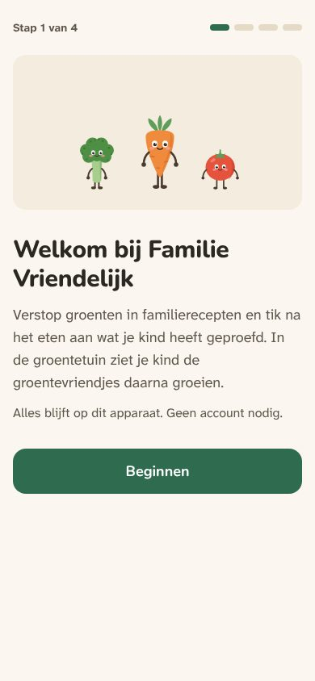 | 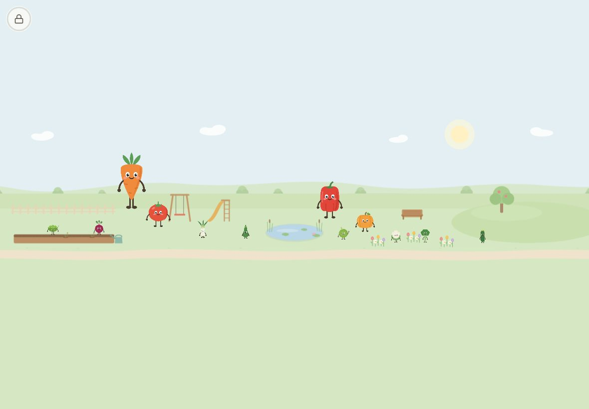 |
| 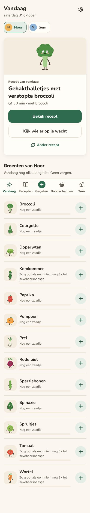 | 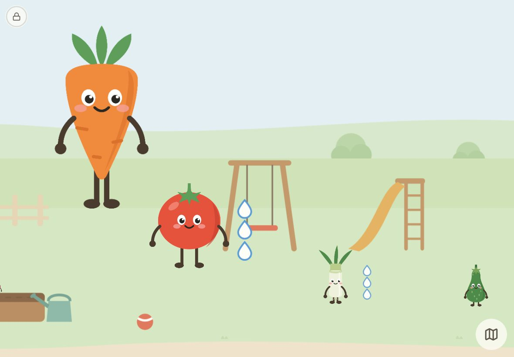 |
| 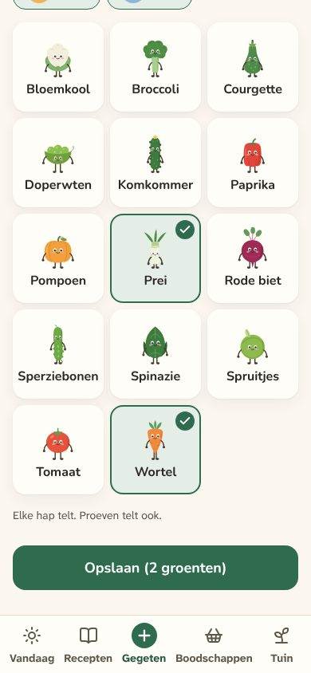 | 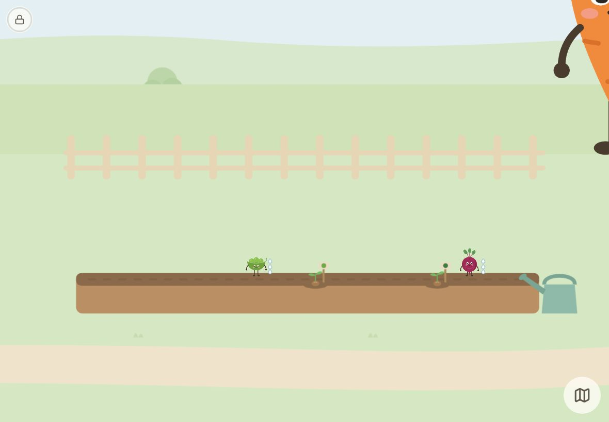 |
| 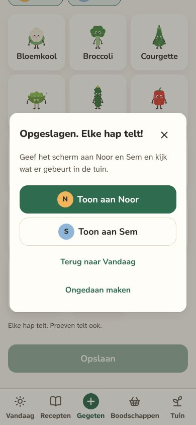 | 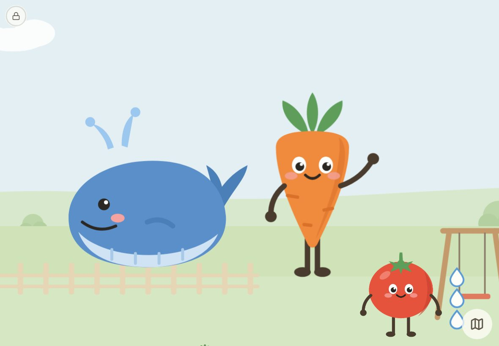 |
| 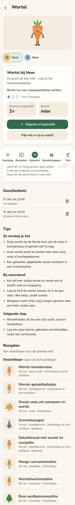 | 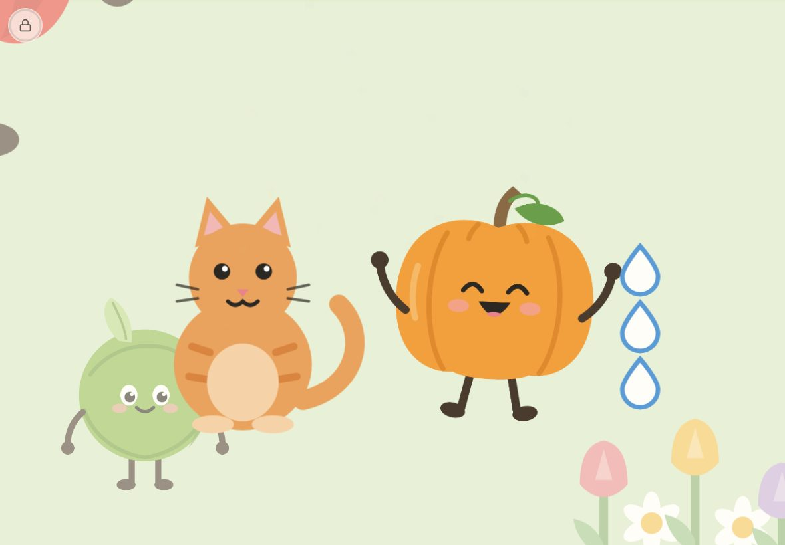 |
| 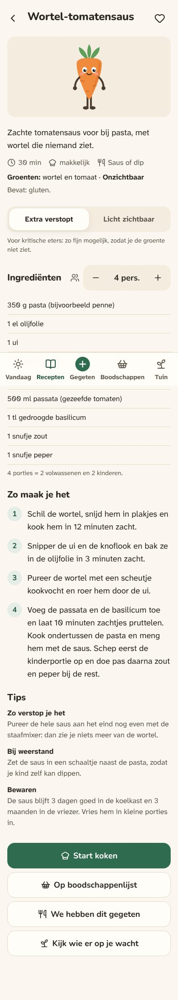 | 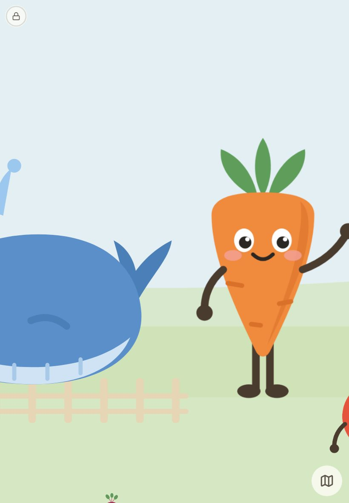 |
| 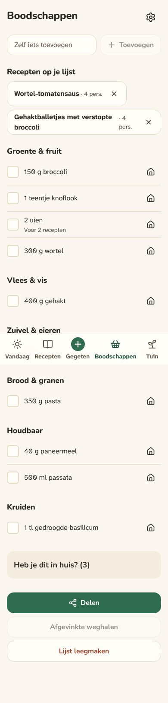 | 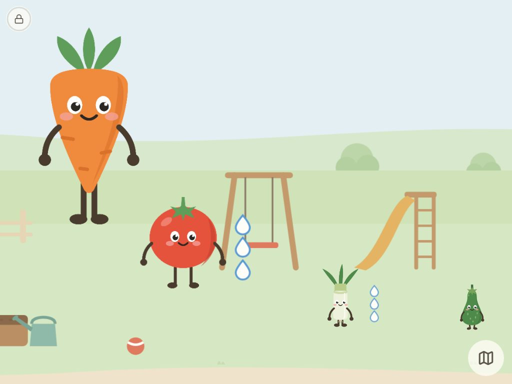 |
| 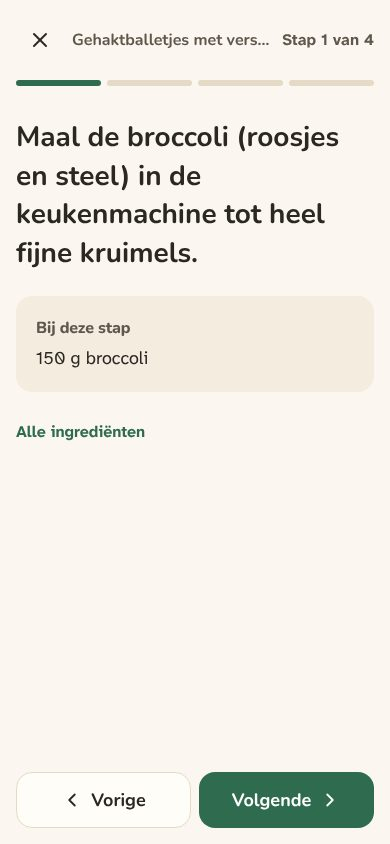 | 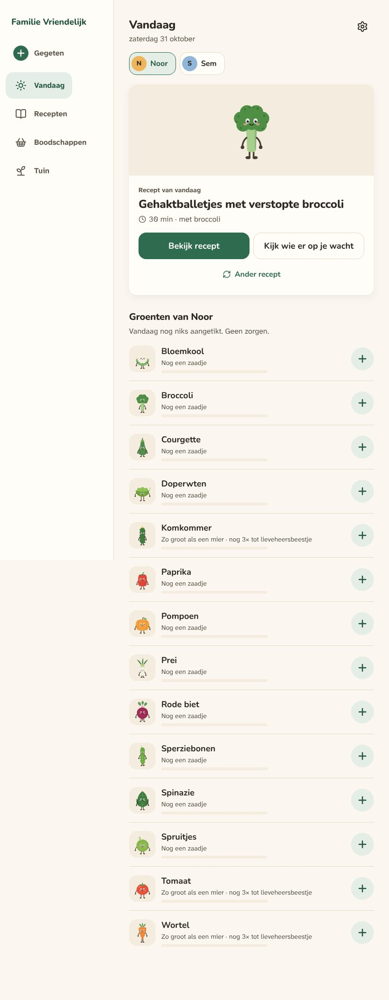 |
